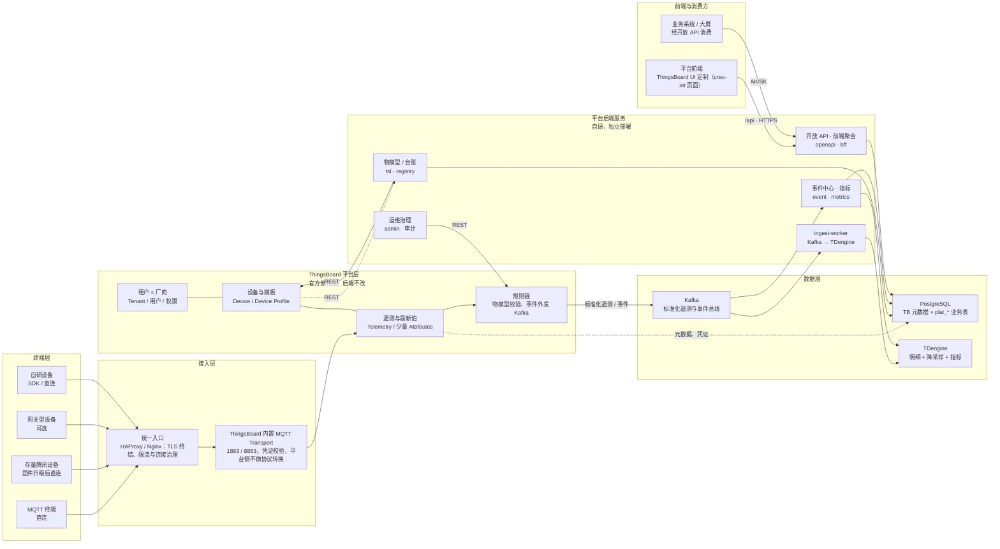

# 2  总体设计

> *中铁信科物联网平台文档集 ｜ 第 2 章* ｜ [总目录](../README.md) ｜ [设计说明书总览](02-总体设计.md) ｜ 上一章 [概述](01-概述.md) ｜ 下一章 [实体模型](03-实体模型.md)

## 2.1  设计原则

**规范优先。** 对外契约以规范为准：设备侧主题、报文结构、鉴权方式不因平台实现而改变；平台内部如何存储与转发，属于实现细节，不传导给设备厂商。

**平台复用。** 设备管理、资产关系、遥测存储、可视化优先使用 ThingsBoard 原生能力；告警实体不使用（见 2.2 决策六），二次开发只补齐规范特有部分，避免重复建设与“平台套平台”。

**防腐层隔离。** 规范与 ThingsBoard 的差异（主题、认证方式、事件语义、类型系统）集中在设备侧 SDK 与物模型服务中消化，底座保持“干净”，升级时只需回归这几层。

**渐进演进。** 所有设备统一直连 ThingsBoard（使用其主题与凭证）；存量腾讯设备按批次升级固件，存量改造与新增建设可分阶段推进。

## 2.2  总体架构

平台在逻辑上分为五层：终端层、接入层、ThingsBoard 平台层、二次开发服务层与数据层；定制前端替换 ThingsBoard 自带 UI 后只调平台后端，业务系统通过开放接口消费数据与下发指令。

*图 2-1  基于 ThingsBoard 二次开发的中铁物联网平台总体架构*

- **终端层**：MQTT 设备（模组/SDK）、网关型设备（可选）与存量腾讯设备（升级固件后直连）；视频类设备（GB/T28181）本期不纳入，预留接入位。
- **接入层**：由 ThingsBoard 内置 MQTT Transport 提供 1883/8883 接入与凭证校验，前置 HAProxy/Nginx 做统一入口与限流；腾讯 `$thing` 报文由设备侧 SDK 转为 TB 主题，平台不部署外部 Broker，也不做平台侧协议转换。
- **ThingsBoard 平台层**：按厂商划分租户，承担设备与模板管理、遥测与属性存储、规则链处理、仪表板与可视化；二次开发不修改其内核与表结构。
- **二次开发服务层**：一个独立部署的平台后端服务（物模型、台账、汇聚、开放 API、运维工具），加上 ThingsBoard 前端的定制构建；ThingsBoard 后端不改。
- **数据层**：PostgreSQL 存元数据与凭证，Kafka 作消息总线，TDengine 存时序遥测；全量遥测不在底座落库，只保留最新值。

架构上有六个关键决策，需要在整个实施过程中保持一致：

- **决策一：统一直连。** 新设备与存量设备都直连 ThingsBoard；存量腾讯设备升级固件、改用 TB 凭证与主题，不设现场网关做协议转换。
- **决策二：不引入外部 Broker。** 社区版无法外挂 EMQX/Mosquitto 做认证回调，自研 transport 又会脱离官方升级路径；因此 MQTT 直连底座，凭证用 Access Token / X.509 / MQTT Basic，协议转换只在设备侧完成。
- **决策三：TSL 与 Profile 分离。** 物模型服务是 TSL 的唯一权威，设备模板由生成器按规则创建/更新；不允许在 ThingsBoard 界面中手工改模板，防止定义漂移。
- **决策四：租户即厂商。** 厂商用租户强隔离、自助上传；中铁侧只保留一个超级管理员，业务组织树放在平台台账，不塞进任何厂商租户。
- **决策五：只改前端、后端自立。** ThingsBoard 后端不引入插件、不改源码；新增能力全部在新服务中实现，前端只调新服务，保证底座可随时升级、回退。

- **决策六：Telemetry 单通道、不用 Alarm。** 属性与事件都走遥测，平台落事件表；Attributes 只保留 `tsl_version`/`tsl_schema`、配置、影子与 OTA 等少量键；ThingsBoard 的告警实体不使用，避免一套异常两套状态。完整规范（承载口径、Attributes 白名单、事件契约、数据模型、迁移与验收）见《遥测单通道设计说明》。
## 2.3  部署形态

建议以 Kubernetes（或 Docker Compose 起步）部署，最小生产形态为 3 个应用节点 + 独立数据库；接入入口与消息队列独立扩容。组件规划如下表。

**表 2-1  平台组件规划**

| 组件 | 作用 | 部署建议 |
| --- | --- | --- |
| ThingsBoard Web / Core | 实体管理、规则引擎、REST API | 2~3 副本，Kafka 队列解耦 |
| platform-service | 物模型、台账、汇聚、开放 API（自研） | 独立部署，≥2 副本 |
| 定制前端（Nginx） | TB UI 定制产物与自研页面 | 静态资源，随版本发布 |
| MQTT Transport（内置） | 设备接入与凭证校验（仅 MQTT） | 与 Core 同部署，按连接数扩容 |
| HAProxy / Nginx | 统一入口、TLS 终结、连接与速率限制 | 2 节点 + Keepalived（可选） |
| PostgreSQL 14+ | 元数据、凭证、固件包（底座强依赖） | 主备 + 定期备份 |
| Kafka | 消息总线、遥测外发、汇聚消费 | 3 broker，按主题分区 |
| TDengine 3.x | 时序遥测与降采样 | 3 节点副本，按时间分区 |

---

*本文是《中铁信科物联网平台设计说明书》第 2 章，返回 [总目录](../README.md)。*
