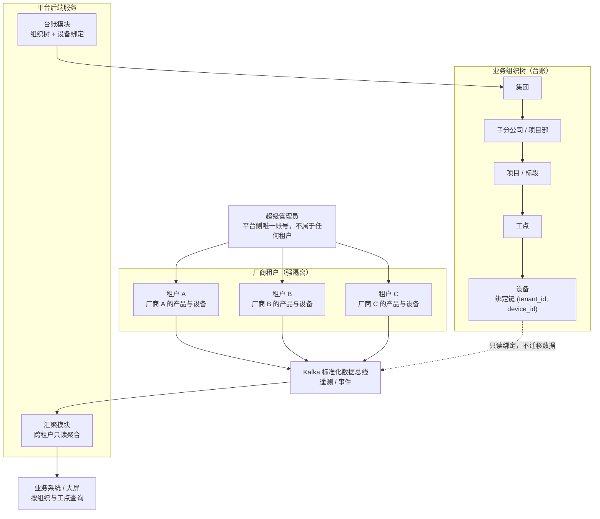

# 6  数字孪生建模与数据加工

> *中铁信科物联网平台文档集 ｜ 第 6 章* ｜ [总目录](../README.md) ｜ [设计说明书总览](02-总体设计.md) ｜ 上一章 [设备接入](05-设备接入.md) ｜ 下一章 [二次开发](07-二次开发.md)

## 6.1  层级建模方法

数字孪生在本项目分两层：**租户内的设备拓扑**（厂商维护）与**平台的业务组织树**（中铁维护）。前者回答“设备怎么连、属于哪个设备组或子设备”，后者回答“设备在哪个项目、哪个工点、为谁服务”。两层由设备台账的绑定关系连接，缺一不可。

*图 6-1  租户=厂商、业务树在台账：设备与组织的关系*

建模按五步执行：① 超级管理员开通厂商租户并创建厂商管理员；② 厂商导入 TSL、创建产品与设备；③ 平台维护组织树与项目/工点；④ 厂商或平台完成设备—工点绑定；⑤ 汇聚模块按绑定维度产出工点/项目指标。前两步在租户内闭环，后三步在平台侧闭环。

为什么不在 ThingsBoard 里建业务树：跨租户无法建立 Relation；把组织树放进任一厂商租户都会破坏隔离；设备改绑、项目重组在台账中只是一条记录的变更，而在 TB 中意味着跨实体的关系迁移。因此采用“设备拓扑在租户内、业务组织在台账、指标在汇聚层”的三层分工。

与数字孪生的对应：设备孪生 = 租户内的 Device + 遥测 + 事件 + 影子；工点/项目孪生 = 台账节点 + 汇聚指标 + 大屏。两者通过绑定关系连成一张图，业务人员按组织看设备，运维人员按厂商看设备，各得其所。

## 6.2  聚合与指标

聚合统一在平台后端服务的**汇聚模块**完成：社区版不提供计算字段，规则链只负责校验与外发。汇聚模块消费 Kafka 中的标准化遥测，按设备、工点、项目、厂商四个维度计算指标，写入指标表（TDengine 或 PostgreSQL）。

同一指标只在一个地方计算，防止口径分裂：工点/项目类指标按台账绑定关系聚合，厂商内部指标按租户聚合，两者共享同一套计算逻辑。

**表 6-1  典型聚合指标**

| 指标 | 计算口径 | 实现方式 | 刷新周期 |
| --- | --- | --- | --- |
| 工点在线率 | 绑定设备在线数 / 绑定设备总数 | 汇聚模块：按绑定维度聚合 | 1 分钟 |
| 工点活动事件数 | 绑定设备未关闭的事件计数 | 汇聚模块：订阅事件流聚合 | 1 分钟 |
| 工点平均温度 | 绑定设备 temp 的均值 | 汇聚模块：按设备维度聚合 | 1 分钟 |
| 厂商设备在线率 | 租户内在线设备数 / 设备总数 | 汇聚模块：按租户聚合 | 1 分钟 |
| 设备离线时长 | 当前时间 − 最后上报时间 | ingest：心跳超时判定 | 5 分钟 |

简单口径（如离线时长）由 ingest 的定时任务计算；复杂口径（跨租户、跨设备类型）放到汇聚模块。结果键名需统一登记，避免前端各自造键。

## 6.3  事件中心设计

平台不使用 ThingsBoard 的 Alarm 实体，所有异常统一表达为遥测事件与平台事件表（`plat_event`）。事件报文、幂等键与区间事件定义见《遥测单通道设计说明》第 6 节。事件分两类：设备上报（`event_type` 保留键）与平台判定（离线、指标越限、校验连续失败）。

**表 6-2  事件类型与处理策略**

| 事件类型 | 触发方式 | 级别 | 收敛方式 | 通知 |
| --- | --- | --- | --- | --- |
| 设备离线 | 心跳超时（默认 3 个上报周期） | MAJOR | 心跳恢复自动补 `end_ts` | 邮件/Webhook |
| 设备故障 | 设备上报 `event_type=fault` | CRITICAL | 恢复事件或人工关闭 | 短信/电话（严重） |
| 超速/越界 | 设备上报 `event_type=alert` | MAJOR | 恢复事件或窗口超时 | 站内 + 邮件 |
| 低电量 | `alert` 事件或指标越限 | MINOR | 电压恢复 | 站内 |
| 数据异常 | TSL 校验连续失败 5 分钟 | WARNING | 校验恢复 | 运维工单 |

其他约定：事件归属厂商租户，跨厂商汇总由事件中心按租户维度聚合；同一 `(device, event_id, event_ts)` 幂等，同一类型在 5 分钟窗口内合并；`info` 只入时间线不发通知；通知按级别分级，CRITICAL 走即时通道；处置（确认、备注、关闭）写 `plat_event` 并记审计。

## 6.4  数据留存与查询

**表 6-3  数据留存策略**

| 数据类别 | 存储 | 保留策略 | 说明 |
| --- | --- | --- | --- |
| 原始遥测 | TDengine | 3~12 个月（按业务定） | 按天/周分区，开启压缩 |
| 降采样遥测 | TDengine | 永久 | 1 分钟/1 小时聚合，供趋势分析 |
| 属性 | PostgreSQL | 永久 | 仅静态元数据、配置、影子与 OTA 键（见 5.4） |
| 事件记录 | PostgreSQL | 2 年 | 含级别、处置与通知记录 |
| 事件明细 | TDengine | 6 个月 | info 类事件体量较大，可归档 |
| 审计日志 | PostgreSQL | 1 年 | 登录、配置变更、指令下发 |
| 固件包 | TB 资源库（默认落 PostgreSQL） | 按版本保留 | 与 OTA 记录关联 |

查询侧统一走开放 API：最新值查询读缓存，历史查询走降采样表，明细查询限制时间窗口；禁止业务系统直连时序库，避免慢查询拖垮写入。

---

*本文是《中铁信科物联网平台设计说明书》第 6 章，返回 [总目录](../README.md)。*
