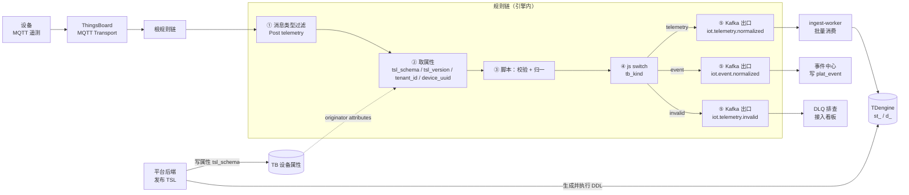
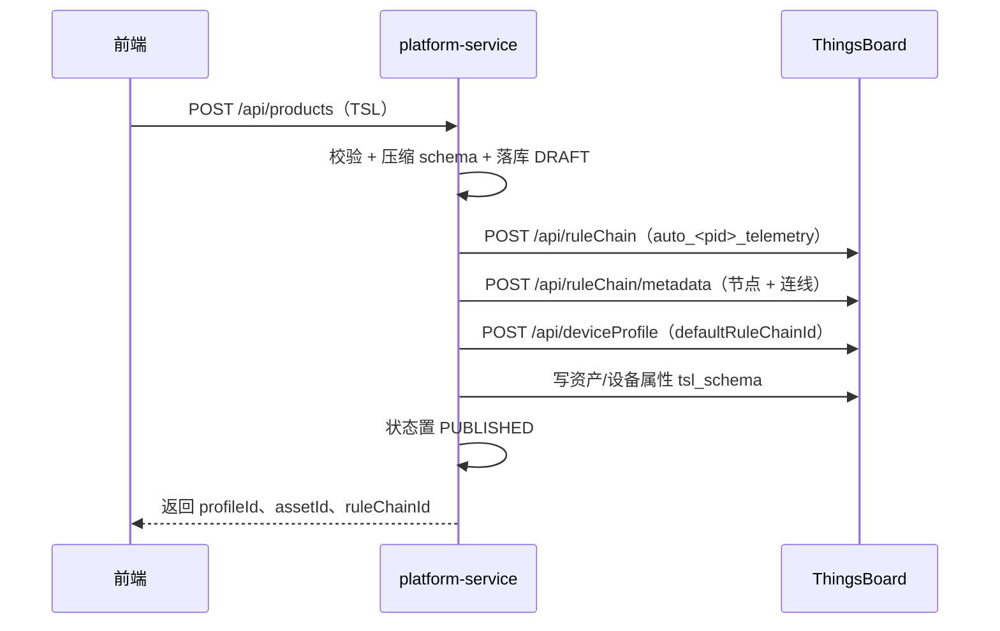

# 物模型遥测入湖链路设计

> *中铁信科物联网平台文档集 ｜ 数据链路* ｜ [总目录](../README.md) ｜ 上一份 [12-遥测单通道设计](12-遥测单通道设计.md) ｜ 返回 [README](../README.md)

本文描述“**收到遥测 → 按物模型校验 → 推 Kafka → 落 TDengine**”这条链路的实现，主力是 ThingsBoard 规则引擎；平台后端只做两件薄事：发布 TSL 时生成并执行 TDengine DDL、消费 Kafka 批量写入。属性与事件的承载口径见《遥测单通道设计说明》，接入与实体模型见《中铁信科物联网平台设计说明书》。

## 1  目标与边界

| 目标 | 做法 |
| --- | --- |
| 接收即校验 | 规则链按设备 `tsl_schema` 校验键名、类型、范围、必填，不合法进 DLQ |
| 接收即归一 | 规则链把报文封装成统一信封（租户、设备、产品、TSL 版本、时间戳） |
| 接收即入总线 | 规则链内 Kafka 节点直接外发，不经平台后端 |
| 按物模型落表 | 一个产品一张 TDengine 超级表，TSL 属性即列，设备即子表 |
| 口径单一 | 规则链只做校验与投递；写入批量、建模与查询在 ingest 与查询服务 |

不在本文范围：事件中心的通知与处置（见《遥测单通道设计说明》第 6、7 节）、仪表板、OTA。

## 2  总体链路

*图 1  物模型驱动的遥测入湖链路*



链路只经过一次规则链、一次 Kafka、一次批量写入，没有中间服务做协议转换，也没有“平台后端转发遥测”的同步调用。

## 3  职责划分

| 环节 | 负责 | 不负责 |
| --- | --- | --- |
| 规则链 | 校验、归一、按 kind 分流、投递 Kafka | 查库、写库、调 HTTP、建表 |
| Kafka | 削峰、解耦、多消费组复用 | 业务语义 |
| ingest-worker | 批量消费、按产品建/加列、批量写 TDengine、DLQ、指标 | 校验语义（规则链已做） |
| 平台后端 tsl 模块 | 发布时生成 DDL、写 `tsl_schema`、版本对齐 | 逐条处理消息 |

这样切的理由：规则链是 Java 写的同步管道，吞吐受节点数与属性查询限制（见 4.7.4 的 200 条/秒经验值），校验放这里最省一跳；写入是 IO 密集，放 ingest-worker 才能批量化。

## 4  物模型如何驱动

| 物模型元素 | 驱动对象 | 生效方式 |
| --- | --- | --- |
| `profile.ProductId` | TDengine 超级表名 `st_<product>` | 发布 TSL 时生成 `CREATE STABLE` |
| `properties[].id` | 超级表列名 | 同上；新增属性用 `ALTER STABLE ADD COLUMN` |
| `define.type` | 列类型 | bool→BOOL、int→BIGINT、float→DOUBLE、string→NCHAR(n)、enum→INT、timestamp→BIGINT、struct→NCHAR（JSON） |
| `define.min/max/required` | 规则链校验 | 写入压缩 schema 的 `keys`，见《遥测单通道设计说明》 |
| `properties[].name/unit` | 列注释、目录接口 | 不进报文，前端从目录取 |
| `events[]` | Kafka 事件消息的 `event` 字段 | 规则链识别保留键后单独投递 |
| 设备与产品关系 | 子表 `d_<device>` 与 TAGS | 首条消息或开通时建子表 |

**自动的含义**：TSL 发布成功即触发 DDL 生成与执行；设备首次上报即创建子表；TSL 新增属性即加列。三处都不需要人工写 SQL。

## 5  规则链设计

### 5.1  节点与配置

在根链的 `Post telemetry` 分支插入以下节点，其他分支（属性、RPC、连接事件）保持原样。

**表 1  规则链节点配置**

| # | 节点类型 | 关键配置 | 说明 |
| --- | --- | --- | --- |
| ① | message type switch | 已有节点，`Post telemetry` 连下游 | 只处理遥测 |
| ② | originator attributes | server attributes：`tsl_schema`、`tsl_version`、`tenant_id`、`device_uuid`、`site_code` | 注入 `metadata.ss_*`；只勾 server scope，不勾 latest values |
| ③ | script | 贴入 `rules/telemetry_to_kafka.js` | 输出信封，打标 `metadata.tb_kind` |
| ④ | js switch | 脚本 `return metadata.tb_kind;` | 三分支：telemetry / event / invalid |
| ⑤a | kafka | topic `iot.telemetry.normalized`，key `$[deviceName]` | 遥测主体 |
| ⑤b | kafka | topic `iot.event.normalized`，key `$[deviceName]` | 事件与参数 |
| ⑤c | kafka | topic `iot.telemetry.invalid`，key `$[deviceName]` | 校验失败样本 |

Kafka 节点的占位符语法随版本略有差异（`$[deviceName]` 或 `${deviceName}`），以界面保存后导出的节点配置为准；topic 名固定，不做按产品分 topic（理由见第 7 节）。

### 5.2  校验与归一脚本

脚本全文见 `rules/telemetry_to_kafka.js`，行为如下：

- 读 `metadata.ss_tsl_schema`，解析失败记 `_schema:parse`，不阻断；
- 事件保留键 `event_id` / `event_type` / `event_ts` 拆出，其余键作为值或事件参数；
- 遥测键按 schema 校验类型与范围，未知键在非严格模式下丢弃并记入 `dropped`；
- 事件参数不要求在属性目录里，原样保留；
- `req=true` 的键缺失记 `:missing`；
- 输出统一信封，`invalid` 非空时 `tb_kind=invalid`。

已用 6 组输入回归（正常遥测、类型错误、带参数事件、未知键、无 schema、非法事件类型），输出符合预期。

### 5.3  失败与重试

| 场景 | 行为 |
| --- | --- |
| Kafka 不可用 | 节点抛异常，TB 记规则链失败日志；消息不重放，依赖设备下个周期 |
| 校验失败 | 进 `iot.telemetry.invalid`，不阻断其他设备 |
| 脚本异常 | 节点进入 failure 分支时连到 log 节点并结束，避免整条链中断 |
| 属性缺失 | 无 schema 时透传，`productId` 为空，ingest-worker 记 `unknown_product` 并丢弃 |

### 5.4  规则链自动下发（发布即生效）

规则链不靠人工在 UI 里搭，否则每上一个产品就要重复一遍九节点配置，错误率比代码高。做法是**模板 + 参数替换 + 幂等保存**：模板在目标 TB 版本上手工验证一次，之后发布流程只替换 Kafka 地址、topic、key 占位符与校验脚本。

*图 2  物模型发布后自动生成并绑定规则链*



**表 3  规则链下发端点**

| 步骤 | 接口 | 用途 |
| --- | --- | --- |
| 1 | `GET /api/ruleChains?textSearch=auto_<pid>_telemetry` | 按名查链，幂等判据 |
| 2 | `POST /api/ruleChain` | 建链（存在则带 `id` 更新） |
| 3 | `POST /api/ruleChain/metadata` | 一次保存全部节点与连线 |
| 4 | `GET /api/deviceProfile/{id}` + `POST /api/deviceProfile` | 把链设为产品模板默认链 |
| 5 | `POST /api/plugins/telemetry/DEVICE/{id}/attributes/SERVER_SCOPE` | 设备级 `tsl_schema`（开通时） |

**稳定节点 id。** 节点 id 由 `UUIDv3(chainId + "|" + key)` 派生，重复下发 id 不变，TB 侧是更新而不是新建节点，UI 上不会留下重复链。节点连线用数组下标（`fromIndex`/`toIndex`），连接类型是标签（`Post telemetry`、`Success`、`True`、`False`、`Failure`），写错会“保存成功但不走线”。

**只绑产品模板，不动租户根链。** 把链设为 `DeviceProfile.defaultRuleChainId`，影响面限于该产品；租户根链唯一且承载其他分支（RPC、连接事件），改错会波及该厂商全部设备。

**配置项**（platform-service `application.yml`）：

**表 4  规则链下发配置**

| 配置 | 缺省 | 说明 |
| --- | --- | --- |
| `crec.tb.kafka-bootstrap` | `kafka:9092` | Kafka 地址，写进三个 Kafka 节点 |
| `crec.tb.topic-telemetry` | `iot.telemetry.normalized` | 遥测 topic |
| `crec.tb.topic-event` | `iot.event.normalized` | 事件 topic |
| `crec.tb.topic-invalid` | `iot.telemetry.invalid` | 校验失败 topic |
| `crec.tb.key-pattern` | `$[deviceName]` | 分区 key 占位符，随版本可变 |
| `crec.tb.rulechain-template` | `telemetry-ingest.template.json` | 按 TB 大版本准备多份 |
| `crec.tb.rulechain-script` | 空 | 非空时从文件读脚本，便于不重启更新 |

**失败处理。** 任一步失败都抛 `SyncFailed`，产品保持 DRAFT，`/api/products/{pid}/sync` 可重试；因为节点 id 与链名都稳定，重试是幂等的。

**验证。** 预发环境发布一个产品，在 UI 打开链确认九节点与连线齐全、`debugMode` 可临时打开；用样例报文跑一遍，确认三个 topic 各自收到消息。切到生产前把 `debugMode` 关掉，避免日志放大。

**版本适配。** `TbGetAttributesNode` 的 `fetchTo`、Kafka 节点的 `keyPattern` 占位符、脚本节点类型名在 3.4–3.7 之间变过；因此模板按版本存（`telemetry-ingest.template.json` 对应 3.6/3.7），升级 TB 时只换模板文件，不改代码。

**脚本来源。** 校验脚本 `rules/telemetry_to_kafka.js` 同时打包在 `resources/rulechain/` 下，发布时作为节点 `configuration.jsScript` 的字符串写入；改脚本只需发改脚本的那份文件，节点结构不变。

## 6  消息契约

**遥测消息**（`iot.telemetry.normalized`）：

```json
{
  "v": 1,
  "tenantId": "b1f0c1a0-…",
  "deviceId": "a7c2…",
  "deviceName": "WIFI_DIAG_0001",
  "productId": "9HYN9PJNOY",
  "tslVersion": "1.0",
  "siteCode": "S-001",
  "ts": 1758000000123,
  "kind": "telemetry",
  "values": { "accX": 0.12, "rssi": -62 },
  "dropped": null,
  "event": null,
  "invalid": null
}
```

**事件消息**（`iot.event.normalized`）：结构相同，`kind="event"`，`event` 为 `{"id","type","ts","data"}`，其中 `event.id` 为 TSL `events[].id`（如 `refuelRecord`），事件参数在 `event.data`；`level` 不进入消息，由 ingest/event-center 按 `type` 映射为 `INFO/MAJOR/CRITICAL`；也支持事件数组，此时信封使用 `events` 数组，每个元素结构同上，`event` 为 `null`；同一包内 `events[].id` 必须一致，混合事件标记 `events:mixed`；无数据的字段输出 `null`，即 `values/dropped/invalid` 为空时为 `null`。

**失败消息**（`iot.telemetry.invalid`）：结构相同，`invalid` 非空（如 `["accX:float","rssi:min"]`），供排查与规则命中率统计。

约定：`ts` 统一毫秒；`productId` 来自 schema；`deviceId` 与 `tenantId` 来自 server 属性，规则链不查库。

## 7  Kafka 规划

| 项 | 值 | 说明 |
| --- | --- | --- |
| topic | `iot.telemetry.normalized` / `iot.event.normalized` / `iot.telemetry.invalid` | 三个固定 topic |
| 分区 | 12（可按吞吐调） | 以设备为 key，单设备有序 |
| key | `deviceName` | 同一设备的消息落到同一分区 |
| 副本 | 3 | 生产要求 |
| 保留 | 7 天 | 支持重放与回填 |
| 压缩 | lz4 | 遥测重复键多，压缩率高 |
| 消费组 | `ingest-tdengine` / `event-center` / `dlq-viewer` | 各自独立位点 |

**为什么不按产品分 topic**：产品数会随厂商增长到几十上百，topic 数量、分区数与 ACL 都随之膨胀；产品维度已经在消息体与超级表名里，消费端按 `productId` 路由即可。若确需隔离（如大客户专线），再为个别产品单独开 topic，而不是全局按产品切。

## 8  TDengine 建模

### 8.1  一产品一超级表，一设备一子表

**表 2  建模要素**

| 要素 | 规则 |
| --- | --- |
| 超级表 | `st_<productId>`，小写，非字母数字换下划线 |
| 子表 | `d_<deviceId>`，`USING st_<productId> TAGS (...)` |
| 时间列 | 首列 `ts TIMESTAMP`（毫秒） |
| 属性列 | TSL 每个属性一列，列名反引号包裹；`ts` 与时间列重名时映射为 `ts_v` |
| 标签 | `device_id`、`device_name`、`tenant_id`、`site_code`（NCHAR(64)） |
| 保留策略 | `KEEP 365d`，按天分区；按业务可调 |
| 压缩 | 默认压缩 + 二级压缩，遥测场景约 1/8~1/12 |

### 8.2  建表语句

由 `work/gen_tdengine_ddl.py` 按 TSL 生成，样例见 `sql/tdengine_9HYN9PJNOY.sql`：

```sql
CREATE STABLE IF NOT EXISTS st_9hyn9pjnoy (
  ts TIMESTAMP,
  `accX` DOUBLE,
  `accY` DOUBLE,
  `rssi` BIGINT,
  `bssid` NCHAR(256),
  `ts_v` BIGINT
) TAGS (device_id NCHAR(64), device_name NCHAR(64), tenant_id NCHAR(64), site_code NCHAR(64));
```

### 8.3  加列与变更

| TSL 变更 | 动作 | 谁执行 |
| --- | --- | --- |
| 新增属性 | `ALTER STABLE st_x ADD COLUMN \`k\` DOUBLE;` | 发布流程自动 |
| 属性类型变更 | 新增列 `k_v2` 并双写一个版本，确认后切换 | 人工评审 + 发布流程 |
| 属性删除 | 不删列，停止写入，目录标记 deprecated | 发布流程 |
| 产品下线 | 停写，超级表保留只读 | 运维 |

TDengine 不支持改列类型与删列，所以类型变更按“加列 + 双写 + 切换”处理，这与 TSL 的版本化天然配合。

## 9  ingest-worker 服务设计

### 9.1  为什么独立部署

| 维度 | platform-service | ingest-worker |
| --- | --- | --- |
| 扩缩依据 | 请求量、并发 | Kafka 积压、写入吞吐 |
| 失败语义 | 返回 5xx | 不提交 offset、重试、进 DLQ |
| 资源特征 | 内存、REST 连接 | 长连接、大 batch、IO 密集 |
| 副本数 | 2 | 3~12（受分区数约束） |
| 发布影响 | 前端随之发版 | 滚动重启，位点不丢 |

同一个进程里跑消费者会带来三个具体问题：API 发版触发 rebalance、API 扩容导致消费者争抢分区、API 内存峰值连带消费停摆。所以 `ingest` 从模块升级为独立服务，与 platform-service 同仓库、不同可执行包、共享 `common`。

### 9.2  消费组与分区

| 消费组 | 订阅 | 写入 | 副本建议 |
| --- | --- | --- | --- |
| `ingest-tdengine` | `iot.telemetry.normalized` | TDengine 子表 | 3 |
| `event-center` | `iot.event.normalized` | `plat_event`（PG） | 2 |
| `dlq-viewer` | `iot.telemetry.invalid` | 只读展示/统计 | 1 |

三个组彼此独立：某一组积压不影响另一组；DLQ 组只做展示，不阻塞主链路。

| Kafka 参数 | 值 | 原因 |
| --- | --- | --- |
| `partitions` | 12 | 消费者上限 = 分区数，留 4 倍扩容 |
| `group.instance.id` | Pod 名 | 静态成员，滚动重启不触发整组 rebalance |
| `partition.assignment.strategy` | `CooperativeStickyAssignor` | 增量式再均衡，减少停顿 |
| `session.timeout.ms` | 30000 | 平衡误判与故障切换 |
| `max.poll.interval.ms` | 300000 | 必须大于“取批 + 写库 + 重试”最坏耗时 |
| `max.poll.records` | 2000 | 与批量写入对齐 |
| `enable.auto.commit` | false | 写成功才提交 |

**扩缩容规则**：实例数从 3 起，积压持续 5 分钟超过阈值加 1 个，最多加到 12（分区数）；超 12 要加分区，加分区后按“先扩分区、再扩实例”的顺序操作。

### 9.3  批量与写入流程

```
poll(500ms, max 2000 条)
  → 解析信封，invalid 非空 → DLQ
  → kind=event → event-center 组处理（本服务跳过）
  → 按 (productId, tslVersion, deviceId) 分组
  → 取列映射（本地缓存，TTL 10 分钟）
  → 首次见到的设备先 CREATE TABLE IF NOT EXISTS 子表
  → 每组拼一条 INSERT ... VALUES (...),(...) ，每批 ≤500 行
  → 写入成功再 ack；失败重试 3 次后进 DLQ 并 ack
```

- **批量插入**：TDengine 支持单条 SQL 多行 `VALUES`，500 行/批在普通节点上约 5~10ms；
- **连接**：每消费线程一条 TDengine 连接，连接数 = 线程数（不建大池，TDengine 侧连接是稀缺资源）；
- **子表缓存**：进程内 LRU（上限 2 万设备），避免每批查元数据；
- **列映射**：`plat_tsl_property(id, product_id, tsl_version, column_name, data_type)`，与 `tslVersion` 绑定，旧消息不会按新列写。

### 9.4  幂等与乱序

- **幂等**：TDengine 对同一子表同一 `ts` 的写入是覆盖语义，at-least-once 不产生重复行；rebalance 导致的重复消费同样无副作用；
- **乱序**：保留期内允许乱序写入，查询按 `ts` 排序；离线补传照常落库；
- **补数**：用新消费组从 7 天保留期内任意位点重放，覆盖即修复。

### 9.5  背压与降级

| 情况 | 处理 |
| --- | --- |
| Kafka 积压 | 加实例（先确认分区未满）；`lag` 超阈值告警 |
| TDengine 写入慢 | 降批量、增大超时；连续失败暂停消费 30 秒 |
| 单产品风暴 | 按 productId 限速，其余产品正常消费 |
| 未知产品 | 丢弃并记 `unknown_product`，不建表 |
| 列映射缺失 | 只写 `ts` 与标签，记 `schema_miss`，等 TSL 同步后恢复 |

### 9.6  部署与扩缩容

```yaml
apiVersion: apps/v1
kind: Deployment
metadata:
  name: ingest-worker
spec:
  replicas: 3
  strategy:
    rollingUpdate: { maxUnavailable: 1, maxSurge: 1 }
  template:
    spec:
      containers:
        - name: ingest
          image: registry/crec-iot-ingest:1.0.0
          env:
            - name: POD_NAME
              valueFrom: { fieldRef: { fieldPath: metadata.name } }
            - name: JAVA_TOOL_OPTIONS
              value: "-Xms1g -Xmx2g"
          readinessProbe:
            httpGet: { path: /actuator/health/readiness, port: 8081 }
          livenessProbe:
            httpGet: { path: /actuator/health/liveness, port: 8081 }
          resources:
            requests: { cpu: "500m", memory: 1Gi }
            limits:   { cpu: "2",    memory: 2Gi }
```

- **HPA/KEDA**：按 `kafka_consumergroup_lag{group="ingest-tdengine"}` 扩缩，min 3、max 12；
- **PDB**：`minAvailable: 2`，滚动与节点驱逐时不断消费；
- **探针**：readiness 检查 Kafka 连接与 TDengine 连接可用，liveness 只检查进程；
- **优雅停机**：`server.shutdown=graceful` + 先 `consumer.pause()` 再提交当前位置，避免半批写入后 ack 丢失。

### 9.7  监控指标

`ingest_consume_rate`、`ingest_write_rows`、`ingest_batch_latency`、`ingest_dlq_count`、`ingest_unknown_product`、`ingest_schema_miss`、`tdengine_write_errors`、`kafka_consumer_lag`、`kafka_rebalance_total`（按 Pod 维度看，定位热点分区）。

## 10  自动建表与版本对齐

| 时点 | 动作 |
| --- | --- |
| TSL 发布成功 | 生成超级表 DDL → 执行 → 记录 `schema_version`；同时下发规则链并绑定 `defaultRuleChainId` |
| 设备开通 | 建子表（或首条消息时懒建） |
| 服务启动 | 拉取已发布 TSL 列表，比对 `schema_version`，缺失的补建 |
| 新属性上线 | 加列后，ingest-worker 刷新列映射缓存（TTL 到期或收到刷新消息） |

对齐失败不回滚 TSL，而是标记“待人工处理”，因为数据链路可以降级（丢列）但不能丢数。

## 11  容量与性能估算

以 2 万台设备、平均 20 秒一条计算：

| 项 | 估算 |
| --- | --- |
| 消息速率 | 1000 条/秒 |
| 单条信封 | 33 列约 350 B（JSON 约 600 B） |
| Kafka 带宽 | 约 0.6 MB/s，压缩后约 0.2 MB/s |
| 日增行数 | 约 8 640 万行 |
| 原始日增 | 约 30 GB |
| 压缩后日增 | 约 3 GB（1/10） |
| 年存储（2 副本） | 约 2 TB |
| ingest 目标吞吐 | 5 000 行/秒（留 5 倍余量） |
| 规则链能力上限 | 单集群约 200 条/秒（属性查询瓶颈，见 4.7.4） |

**关键结论**：1000 条/秒已经超过规则链的舒适区。若实测属性查询成为瓶颈，把校验从规则链移到 ingest-worker（方案 B：规则链只外发原始报文，ingest-worker 读库校验），代价是校验延迟增加数百毫秒、坏数据会短暂进 Kafka。本文的规则链设计在 200 条/秒以内最稳。

## 12  部署与配置

| 组件 | 关键配置 |
| --- | --- |
| TB Kafka 节点 | `bootstrap.servers`、topic、key 占位符、`acks=all`、重试 3 次 |
| Kafka | 分区 12、副本 3、`min.insync.replicas=2` |
| ingest | `max.poll.records=2000`、`fetch.min.bytes=64KB`、线程数 = 分区数、批量 500 行 |
| TDengine | 客户端连接串、`KEEP`、`PRECISION ms`、写入超时 30 秒 |

## 13  测试用例

| # | 场景 | 期望 |
| --- | --- | --- |
| 1 | 正常遥测 3 个键 | Kafka 一条 telemetry，TDengine 立即可查 |
| 2 | 键类型错误 | 进 invalid topic，TDengine 无数据 |
| 3 | 值超范围 | 同上，`invalid` 标 `:min` 或 `:max` |
| 4 | 事件报文 | 进 event topic，`event.type` 正确，下游按 `type` 映射 `level` |
| 5 | 未知键 | 非严格模式丢弃并记 `dropped` |
| 6 | 无 schema 设备 | 透传，`productId` 为空，ingest 丢弃并记指标 |
| 7 | 重复发送同一报文 | TDengine 行数不变（同 ts 覆盖） |
| 8 | 补传 1 小时前的数据 | 正常落库，查询按 ts 排序 |
| 9 | TSL 新增属性 | ALTER 成功，新键可写入，旧消息不受影响 |
| 10 | Kafka 停止 1 分钟 | 规则链失败计数上升，恢复后新消息正常 |
| 11 | TDengine 重启 | ingest 重试成功，offset 不丢 |
| 12 | 新设备首次上报 | 自动建子表，标签正确 |

## 14  运维

- **加列**：发布流程自动执行；手工补列时先 `ALTER` 再刷缓存。
- **重建**：超级表损坏时新建 `st_x_v2`，双写两天后切查询。
- **回填**：从 Kafka 7 天保留期重放；更早的数据从 TB 历史遥测导出 CSV 再导入。
- **监控**：`kafka.consumer.lag`、`ingest.dlq.count`、`tdengine.write.errors` 三条告警即可覆盖主链路。
- **成本**：TDengine 年增约 2 TB（2 副本），可用降采样表 + `KEEP` 分层控制。

## 15  与现有文档的关系

| 文档 | 关系 |
| --- | --- |
| 《中铁信科物联网平台设计说明书》 | 4.7.4 给出校验脚本与属性 schema，第 5、6 章给出接入与实体模型；本文是 4.7.4 的下游延伸 |
| 《遥测单通道设计说明》 | 规定“属性与事件都走遥测、Attributes 白名单、不用 Alarm”；本文的消息 `kind` 与事件字段与之一致 |
| 《前端页面与产品物模型联动开发指南》 | 规定 TSL 发布时调用 TB 接口；本文的 DDL 生成挂在同一条发布链路之后 |

## 16  产物清单

| 文件 | 用途 |
| --- | --- |
| `rules/telemetry_to_kafka.js` | 规则链脚本节点：校验 + 归一 + 打标 |
| `work/gen_tdengine_ddl.py` | TSL → TDengine 建表语句生成器 |
| `sql/tdengine_9HYN9PJNOY.sql` | 9HYN9PJNOY 的超级表 DDL（33 列、4 标签） |
| `work/push_tsl_schema.py` | 把压缩 schema 写入设备 server 属性 |
| `work/make_schema.py` | 生成压缩 schema |
| `platform-service/.../TbRuleChainProvisioner.java` | 规则链下发器：模板展开、稳定节点 id、绑定产品模板 |
| `platform-service/src/main/resources/rulechain/telemetry-ingest.template.json` | 九节点模板（按 TB 版本维护） |

建议把 `gen_tdengine_ddl.py` 挂到 TSL 发布流程：发布成功 → 生成 DDL → 执行 → 记录版本，这样“物模型改了表结构就跟着改”不靠人记。
---

*返回 [总目录](../README.md)。*
