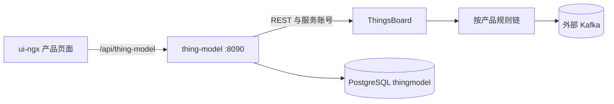
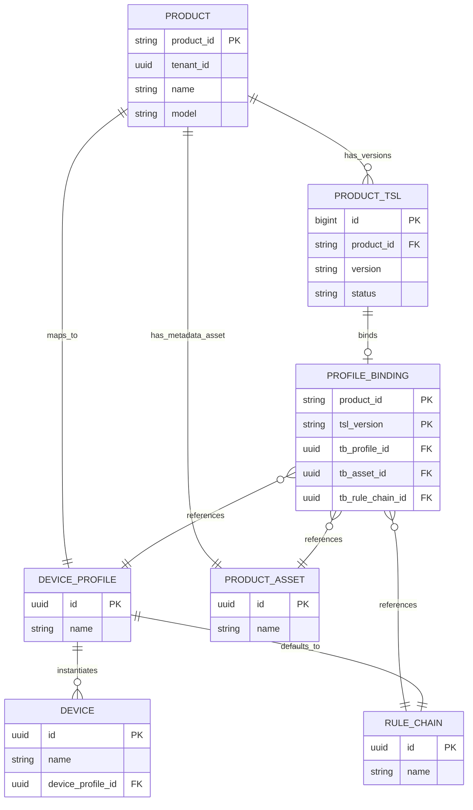
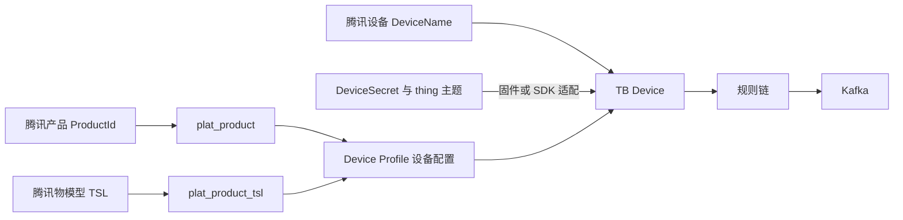
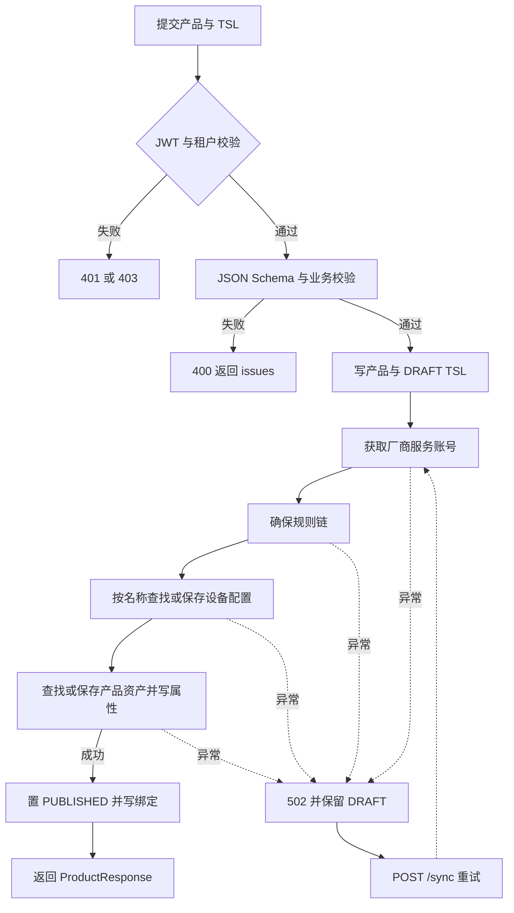
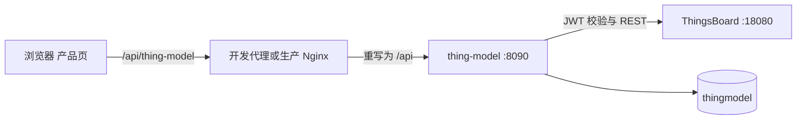

# thing-model 方案评审（含前端调整方案）

## 1. 方案概述

《02-总体设计》要求 ThingsBoard 后端不改，新增能力放在独立服务；《07-二次开发》进一步拆为面向请求的 `platform-service` 和面向吞吐的 `ingest-worker`。当前 `thing-model` 可视为 `platform-service` 的 P1 子集。

| 设计原则 | 依据 | 当前实现 |
| --- | --- | --- |
| ThingsBoard 后端不改 | 02、07 | 满足，仅通过 REST 集成 |
| TSL 与 Profile 分离 | 02 | 满足，TSL 权威在 `plat_*`，设备配置由生成器同步 |
| 租户即厂商 | 03 | 满足，平台表带 `tenant_id`，按租户服务账号写入 |
| 前端只调平台后端 | 07、11 | 产品页满足；会话方式与文档存在两种表述，需统一 |
| ingest 独立部署 | 07、09 | 未实现，属于 P2 |

## 2. 产品、设备配置、资产、设备的关系

> **设备配置 = ThingsBoard Device Profile**（设计文档中也称“设备模板”）；**资产 = ThingsBoard Asset**；**设备 = Device**。

**一句话关系：一个产品对应一个设备配置和一份产品资产；一个设备配置下挂多台设备；设备通过 `deviceProfileId` 归属设备和产品；产品资产只承载产品级 TSL 元数据，不是设备台账。**

| 关系 | 基数 | 承载位置 | 当前状态 |
| --- | --- | --- | --- |
| 产品 → TSL 版本 | 1 : N | `plat_product_tsl` | 已实现，DRAFT/PUBLISHED/DEPRECATED |
| 产品 → 设备配置 | 1 : 1 | ThingsBoard Device Profile | 已实现，按“产品名 + 型号”同步 |
| 产品 → 产品资产 | 1 : 1 | ThingsBoard Asset | 已实现，写入 `tsl_json`、`tsl_schema` 等属性 |
| 设备配置 → 设备 | 1 : N | ThingsBoard Device | 设备不在 `thing-model` 管理范围 |
| 设备配置 → 规则链 | 1 : 1 | ThingsBoard Rule Chain | 已实现，绑定 `defaultRuleChainId` |
| TSL 版本 → 绑定记录 | 1 : 0..1 | `plat_profile_binding` | 记录发布时的 profile/asset/rulechain ID |
| 设备 → 产品 | N : 1 | ThingsBoard Device | 无本地外键，经 `deviceProfileId` 间接推导 |

关键结论：

1. **产品不是设备配置。** 产品是业务主数据，设备配置是承载传输方式、默认规则链的 ThingsBoard 实体。
2. **设备配置不是设备。** 设备配置是类型，设备是实例；一个产品通常只有一个配置，但可以有多台设备。
3. **资产不是设备台账。** 当前资产只承载产品级 TSL 元数据，不包含设备清单，也不承担组织、工点、产权语义。
4. **TSL 版本没有真正下沉到设备。** 规则链校验已改为内嵌产品 `tsl_schema`，不再依赖设备属性；但设备上报信封中的 `tsl_version` 仍需开通/同步时下发，存量设备不会自动刷新。
5. **绑定表不是版本化模板。** `plat_profile_binding` 不能单独实现设备级灰度或回滚。

## 3. 与腾讯 IoT 物模型的对照

本方案沿用腾讯 IoT 的产品、设备、物模型语义，存储与运行时落在 `thing-model` 和 ThingsBoard。对照依据为《03-实体模型》3.6、《04-物模型》4.1/4.7.4、《10-附录》类型映射和《12-遥测单通道设计》。

### 3.1 概念对照

| 腾讯 IoT | 新方案承载 | 当前状态 |
| --- | --- | --- |
| 产品 ProductId / ProductKey | `plat_product.product_id`；写入 Device Profile 描述，ProductKey 当前未单独建模 | 已实现 ProductId |
| 产品分类 CategoryId | `plat_product.category_id`；产品资产属性 | 已实现 |
| 设备 DeviceName | ThingsBoard `Device.name` | P2 |
| DeviceSecret | 凭据库密文 + Access Token / X.509，不使用 HMAC | P2 |
| 物模型 TSL | `plat_product_tsl`，作为唯一权威源 | 已实现 |
| 属性 property | `plat_tsl_property`；上报为遥测键 | 已实现目录与校验 |
| 事件 event | `plat_tsl_event`；通过遥测保留键上报 | 目录已实现，事件中心 P2 |
| 行为 action | `plat_tsl_action`；映射为 RPC | 目录已实现，RPC P2 |
| 设备影子 desired / reported | shared / server attributes | P2 |
| 在线状态 | 心跳遥测 + ingest 判定 | P2 |
| `$thing/*` 主题与 ACL | `v1/devices/me/*` + Access Token | P2，设备侧适配 |
| 规则引擎与数据转发 | ThingsBoard 规则链 → Kafka | 已实现，内嵌 TSL schema 做属性/事件校验，非法数据不落库 |

### 3.2 物模型字段对照

| 腾讯 TSL 字段 | 新方案字段或位置 |
| --- | --- |
| `profile.ProductId` | `plat_product.product_id`、Device Profile 描述 |
| `profile.CategoryId` | `plat_product.category_id` |
| `version` | `plat_product_tsl.version` |
| `properties[].id` | `plat_tsl_property.property_key`，同时作为遥测键 |
| `properties[].mode` | `plat_tsl_property.mode`；`rw` 额外映射 RPC `set` |
| `properties[].define.type` | `data_type`，按 3.3 映射 |
| `min` / `max` / `step` / `unit` | 目录表字段，同时写入压缩 schema |
| `properties[].mapping` | `mapping_json`，仅用于展示翻译，不改变传输值 |
| `events[].id` / `type` | `event_id` / `event_type`，级别为 info、alert、fault |
| `actions[].id` / `input` / `output` | RPC 方法名与请求、返回参数 |

### 3.3 数据类型对照

| 腾讯 TSL 类型 | ThingsBoard / 存储 | 说明 |
| --- | --- | --- |
| bool | boolean | 0/1 归一为 true/false |
| int | long | 注意 32 位上限 |
| float | double | 单位仅元数据，不做换算 |
| string | string | 校验器限制最大长度 |
| enum | long + mapping | 传输数值，展示时翻译 |
| enum_string | string + mapping | 保留字符串键值映射 |
| timestamp | long | 秒级时间戳需 ×1000 |
| struct | json | 不支持嵌套，建议扁平化为 `struct.field` |

### 3.4 运行时行为对照

| 腾讯 IoT 行为 | 新方案 |
| --- | --- |
| 属性上报 `$thing/up/property` | ThingsBoard 遥测 `v1/devices/me/telemetry` |
| 事件上报 | 走遥测，保留 `event_id`、`event_type`、`event_ts` |
| 属性设置 | 映射为 RPC `set`，`rw` 属性使用 |
| 行为调用 | 映射为 RPC，方法名为 `actionId` |
| 影子读写 | desired 写 shared attributes，reported 写 server attributes |
| 设备认证 | 腾讯 HMAC → Access Token / X.509 / MQTT Basic |

### 3.5 落地要点

- ProductId 全局唯一，创建后不可修改；CategoryId 只作分类与筛选。
- DeviceName 直接使用设备名，长度不超过 48，仅英文、数字、下划线。
- 事件不使用 ThingsBoard Alarm，统一走遥测并由后续事件中心处理。
- 协议差异放在固件或 SDK，平台侧不做 `$thing` 主题转换。
- 当前已覆盖产品、TSL、属性/事件/行为目录、设备配置、规则链；设备开通与事件中心按 P2 推进。

## 4. 发布与同步流程

优点：校验前置、同步基本幂等、DRAFT 可重试。主要不足是同步仍在 HTTP 请求内完成，失败后缺少任务状态、差异展示和自动补偿。

## 5. 前端集成与调整

《11-前端联动开发指南》建议使用 `modules/crec-iot/`、`/crec-api` 和独立服务；当前实现使用 `modules/home/pages/product/`、`/api/thing-model`，功能等价但路径和模块归属不同，需在文档和部署配置中统一。

**当前能力：** 产品列表、详情、创建/编辑弹窗、TSL 校验、JSON 导入、属性/事件/行为目录、版本列表、设备配置/资产/规则链跳转，中英文 i18n 已对齐。

**调整方案：**

- **P0：** 补齐加载、错误、空状态和 404；修复编辑表单语义；增加“重新同步”按钮；完整展示错误与警告；固化生产代理和基地址配置。
- **P1：** 服务端分页、排序和搜索；区分当前生效版本与草稿版本；增加发布、弃用、回滚操作；增加产品下设备视图；为 `SYS_ADMIN` 增加厂商服务账号管理页。
- **P2：** 结构化 TSL 编辑器、设备接入向导、事件中心、遥测查询、台账绑定、开放 API/BFF。
